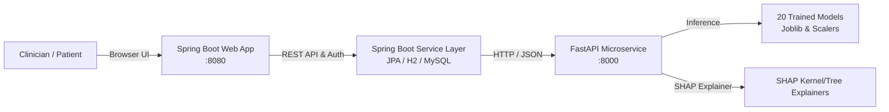

# AI-Based Multi-Disease Risk Prediction and Explainable System

A full-stack clinical decision support and health risk assessment system combining **Spring Boot**, **FastAPI**, **Machine Learning / Deep Learning**, **SHAP (SHapley Additive exPlanations)**, and interactive **Counterfactual "What-If" Simulations**.

---

## 🌟 Key Capabilities

1. **4 Targeted Chronic Conditions**:
   - **Heart Disease**: Cleveland Clinic Clinical Benchmark (13 parameters).
   - **Type-2 Diabetes**: Diagnostic Vitals & Lab Biomarkers (8 parameters).
   - **Cerebrovascular Stroke**: Stroke Risk Factors & Co-morbidities (10 parameters).
   - **Hypertension**: Cardio-metabolic & Blood Pressure Indicators (11 parameters).

2. **5 Machine Learning & Deep Learning Architectures per Disease (20 Trained Models)**:
   - Logistic Regression (Baseline Interpretable)
   - Random Forest Classifier (Ensemble Bagging)
   - XGBoost Classifier (Gradient Boosting)
   - CatBoost Classifier (Categorical Gradient Boosting)
   - Artificial Neural Network / Multi-Layer Perceptron (Deep Learning)

3. **Explainable AI (SHAP XAI)**:
   - Computes exact feature-level SHAP contributions for every patient prediction.
   - Highlights positive risk drivers (red/pushing risk up) vs. protective biomarkers (blue/lowering risk).
   - Generates actionable clinical recommendations tailored to specific elevated lab values.

4. **Counterfactual "What-If" Simulation Engine**:
   - Allows clinicians and patients to manipulate lifestyle factors (e.g., losing weight, lowering fasting glucose, reducing systolic BP) in real time.
   - Computes predicted risk reduction and percentage delta with immediate visual feedback.

5. **Integrated Web Dashboard**:
   - Glassmorphic, modern UI served seamlessly from Spring Boot on `http://localhost:8080`.
   - Preset buttons to instantly load test patient vitals ("Healthy Vitals" vs. "Elevated Risk Patient").
   - Prediction history tracking and model comparison metrics.

---

## 🏗️ Architecture Overview



---

## 🚀 Quick Start Guide

### 1. One-Click Launch (Windows)
Double-click `start-all.bat` in the root folder, or execute in PowerShell:
```powershell
.\start-all.bat
```

### 2. Manual Startup

#### Machine Learning Microservice (FastAPI):
```bash
cd ml-service
.\venv\Scripts\activate
python run.py
```
*Accessible at: `http://127.0.0.1:8000` (API documentation: `http://127.0.0.1:8000/docs`)*

#### Backend & Dashboard (Spring Boot):
```bash
cd backend
.\mvnw.cmd spring-boot:run
```
*Accessible at: `http://localhost:8080` (H2 Database Console: `http://localhost:8080/h2-console`)*

---

## 🧪 Retraining Models
If you wish to retrain or update the model weights using the clinical datasets:
```bash
cd ml-service
.\venv\Scripts\python train_models.py
```
This evaluates all 5 model algorithms across the 4 conditions, calculates ROC-AUC, Accuracy, Precision, Recall, and F1-score, and exports optimal serialized weights with feature scalers and SHAP background distributions.
